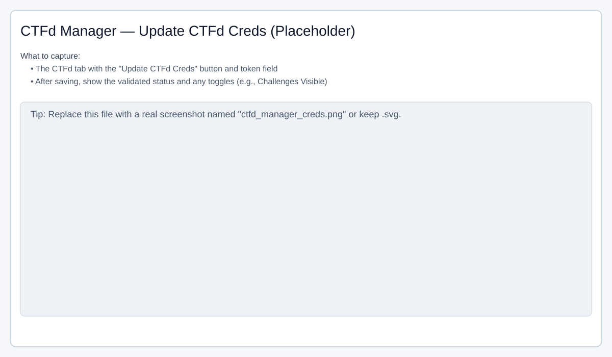
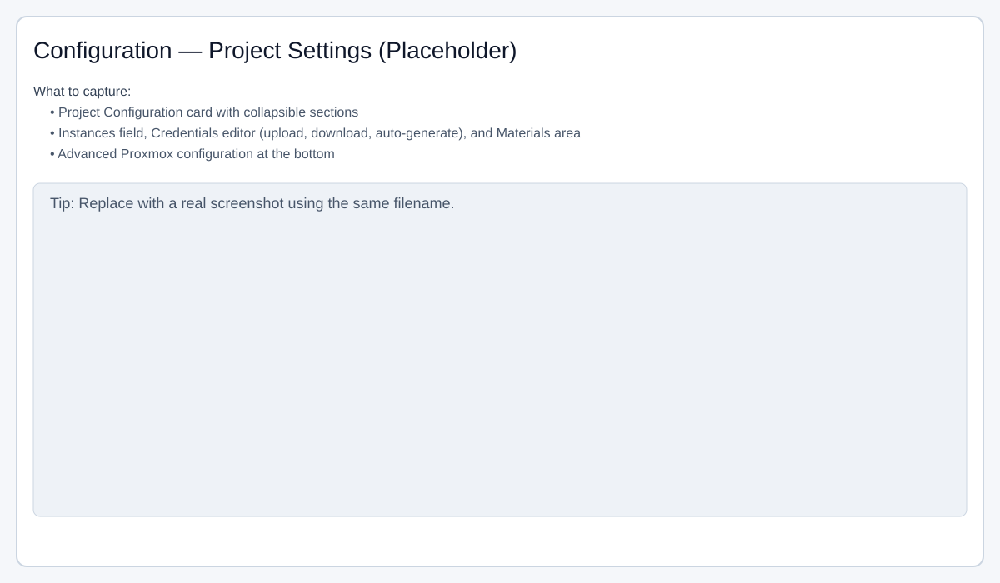
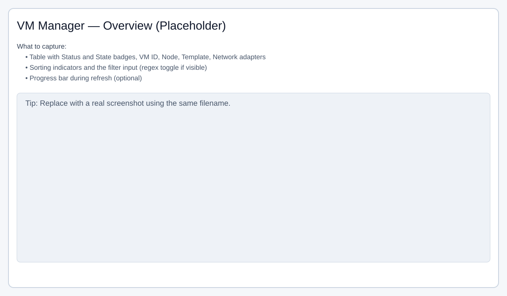
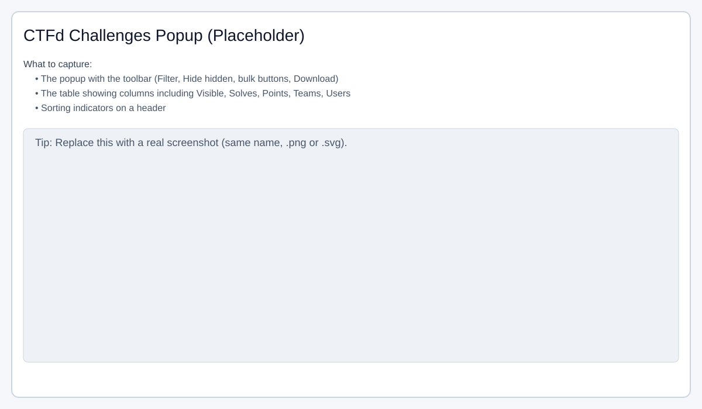
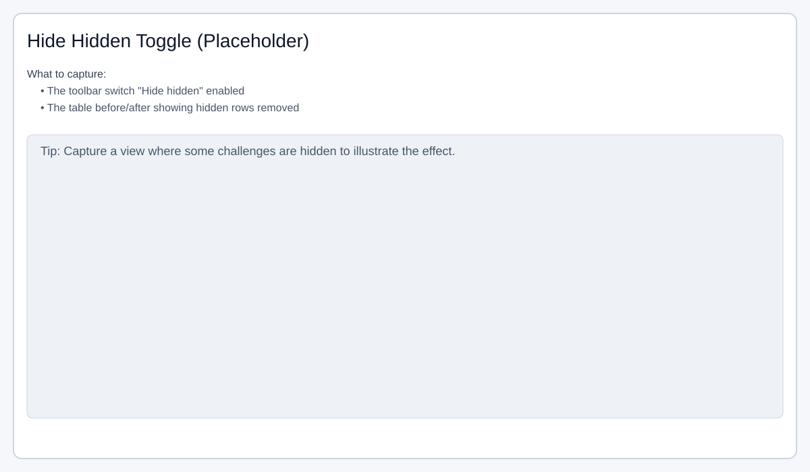
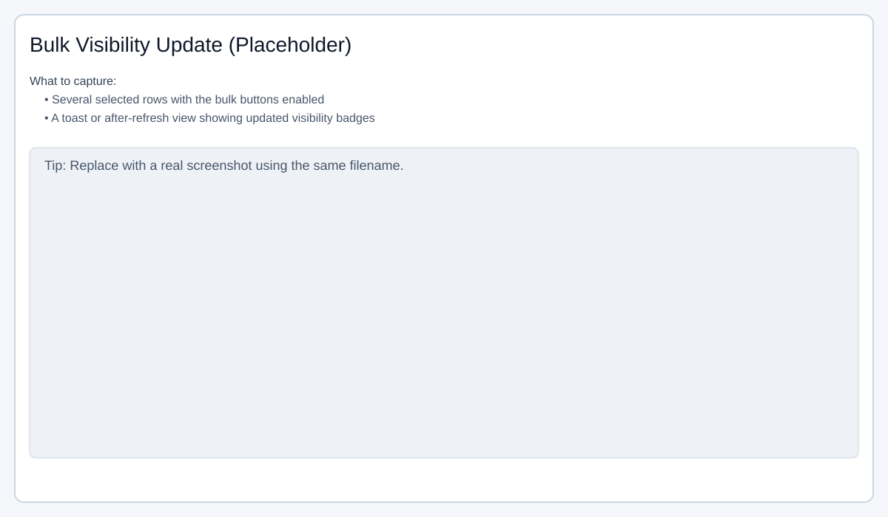

# DeployForge

DeployForge is a Dockerized web UI for configuring CTF/scenario “Projects” and interacting with Proxmox and CTFd via REST APIs. It includes a Bootstrap frontend plus a Flask backend with JSON-backed storage under `DATA_DIR`.

## What you can do

- Create/manage Projects, VMs, Materials, and per-instance Credentials
- Import/export Projects as ZIP bundles (single or multi-project)
- Run Proxmox actions (create/refresh/restore, VM manager UI)
- Manage CTFd settings and challenge visibility (with token-first auth)

Startup, stored, validation, and custom guest commands support [per-instance template variables](docs/command-variables.md), with an optional rendering switch, a command preview, and variable help.

Queued actions run on the server in submission order. Once an upload or action
has been accepted, switching pages, refreshing, closing the tab, or signing out
does not stop it. The Queue dock reconnects to your running, waiting, and recent
completed actions on every manager page. Complete VM, guest-transfer, wizard,
and CTFd bulk plans are submitted together, including their follow-up steps.
The dock keeps waiting/running items in submission order and completed history
newest first. Queued/start timestamps stay attached to their job; individual
polls do not move rows. Persisted revisions reject stale responses, and cached
responses are disabled. Unchanged polls do not redraw the dock; progress updates
preserve its scroll position and expanded results. Refreshing the page only
reconnects to existing work and does not resubmit it.

Validation waits for all selected guest checks, including slower checks and
timeouts. When the run finishes, its returned results update the VM table and
the active filter together, before the completion summary appears. The separate
inventory refresh can finish later; older refreshes and delayed validation
responses cannot replace results from a newer completed run.

Navigation and background inventory, CTFd, and CTF-RPG reads run outside the
action queue, so they can finish while a submitted action is running. Identical
overlapping reads share work within a browser page and within each server
process, scoped to the same session, credentials, and request. Results are not
cached after a read finishes, and mutations separate reads so subsequent
refreshes get fresh state. Leaving a page aborts its background reads without
cancelling accepted actions. Hidden tabs pause queue snapshot polling.
Queue polls load lightweight job state and reuse summaries by persisted revision;
retained archives are loaded for a new completed revision or an explicit result
request. Mutating actions continue to run in submission order across users.

Push, Pull, and Custom Command dialogs each have a **History — last 10 runs**
selector. History is saved on the server for the signed-in user when a run starts,
including failed attempts; cancelled waiting jobs are excluded. Repeating the same
settings moves that entry to the top. Custom history restores the complete command
and timeout, pull history restores the paths, and push history restores the
destination, file/folder mode, owner, and permissions. Push recall retains matching
selected files and can restore the last ten file/folder selections from the same
open page. After a page reload, or if that selection is unavailable, choose the
local files again. Recall keeps the current file or folder selection while restoring
the saved destination and options. A small **(!)** marks files changed since the
recalled run or no longer readable; hover for details. Files reported missing by
the browser are removed from the selection.
Recall never submits an action or changes the currently selected guests.
Connection credentials, target lists, and uploaded file contents are not stored
in recall history. Existing completed jobs are not backfilled, and clearing the
Queue's completed list leaves recall history available.

The queue stores job metadata in `DATA_DIR/action_queue.sqlite3` and streams
queued uploads to `DATA_DIR/queue_uploads` without loading whole files into RAM.
Queued pulls retain ZIPs in `DATA_DIR/queue_outputs` and return download links,
keeping archive bytes out of SQLite and JSON results. Downloads remain available
under **Queue → View results**, including when navigating away from VM Manager.
Keep both directories alongside the database on persistent storage, with
enough free space for queued files and transfer archives. The push dialog shows
upload progress and stays open until the server accepts the job. No separate
worker service is required. WSGI workers share the scheduler through SQLite. Cancellation removes
waiting work and asks running operations to stop at their next cancellation
check. A server process must remain running to execute work. Interrupted running
actions are marked failed when their worker process disappears and are never
automatically replayed. Submitted request credentials and uploaded queue payloads
are cleared after completion. Direct API clients retain the existing synchronous
endpoints; the web UI submits work through `/api/queue`.

A push batch uploads each selected file to the app once, including selections
across projects. With Proxmox SSH credentials, the app stages one archive per
host and reuses it for that host's selected LXC containers and Linux QEMU VMs.
Guest copies run in parallel, including guests on the same host, up to the
project's Max Jobs setting. The host upload completes once before copying starts. The Queue shows the current upload/download byte percentage and
transferred size, separately from the batch count. Archive preparation and
extraction show indeterminate progress. Pull batches use at most four workers
and at most two simultaneous QEMU pulls per node, also respecting Max Jobs.
QEMU downloads start with 1 MiB reads and retry transient proxy/connection failures
at the same offset up to four attempts, reducing requests to 256 KiB as needed.
Retry backoff remains cancellable. LXC downloads temporarily stage an
archive in the guest so the download size is known, then remove it. Staged archives are removed when the batch finishes. QEMU host-side
copies require `python3`, `qm`, a working guest agent, and root/sudo access on
the Proxmox host. The app stages a private temporary Python helper and launches
it with a short SSH command, then removes the helper. It avoids passing the full
program inline through SSH and sudo. With host SSH access, a QEMU copy holds one guest-agent socket
connection and one guest file handle open for the whole archive. Bounded file-write
frames carry the bytes without starting a guest shell or polling a command for each
chunk. This works without guest networking, guest SSH, or additional guest packages.
The socket is released before `qm` extracts the archive. Uploads to the same VM are
serialized on the host; copies to different guests still obey Max Jobs. The temporary
guest archive is cleaned up on success, with cleanup attempted on cancellation or failure. If the guest-agent
file commands are unavailable during preflight, the Queue shows compatible mode
and uses the former bounded-stdin transport. Failed or partial streaming writes are
reported as errors, not retried through another transport. Without a Proxmox SSH
password, QEMU retains the separate per-guest API transfer.
Disconnected SSH clients are discarded from the batch pool so one lost connection
does not immediately fail later guests. A missing SSH exit status leaves the
affected transfer's completion unknown; it is not automatically replayed.

In **Push to Guests**, enable **Map files to VMIDs using CSV** to copy files
already on the DeployForge server or each selected guest's Proxmox host. CSV columns are
`vmid,source-path-on-host,destination-path-in-guest,username`; the fourth column
(username) and header are optional. Columns after the fourth are ignored. For example:

```csv
vmid,source,destination,username,notes
101,/srv/configs/first.json,/etc/scenario/config.json,alice,ignored
102,/srv/configs/second.json,/opt/scenario/settings.json,bob,ignored
```

Both paths must be absolute. A destination ending in `/` is a directory: the
source filename is appended, and the preview shows the resulting full path.
Otherwise the destination specifies the full filename, allowing files to be renamed.
**Read source files from** defaults to **DeployForge server (this host)**. Choose
**Proxmox host running each guest** when sources are on the Proxmox nodes.
No local file selection or browser upload is needed. VMIDs must match selected
guests. Guests absent from the CSV receive no files. Existing guest files are
overwritten and missing destination directories are created. The Advanced owner
and file permissions apply to all rows. This mode requires Proxmox SSH credentials
for both source locations. Reading sources on Proxmox also requires `python3`
there; QEMU requires a working guest agent.
Choosing a CSV automatically previews every row alongside the VM's assigned
username (the VM table's Credentials column), guest name, project, and Proxmox
node. The optional CSV username appears separately for comparison; differences
are highlighted and do not affect the transfer. Row errors and duplicate entries
are shown before pushing. The preview refreshes when reopening the modal, and
**Refresh preview** updates it against the current selection. This checks the
mapping; host source files are read when the queued push runs.
CSV mappings persist with queued actions across page reloads. History recalls
regular upload settings; select the CSV again to repeat its mapping.

## Quick start (Docker)

Prereqs: Docker + Docker Compose.

```bash
docker compose up --build
```

Open:

- http://localhost (port 80)
- https://localhost (port 443, self-signed cert)

Notes:

- Persistent data lives in `./data` (mounted to `/data` inside the container).
- TLS certs are generated by the `certs` service (set `CERT_DNS` if needed).
- When this stack runs on the same Proxmox host it manages, Proxmox API URLs that use `localhost` or `127.0.0.1` are rewritten inside the container to `host.docker.internal`, and Compose injects the required `host-gateway` mapping.
- The Docker deployment uses a 180-second upstream timeout so large VM inventories have more time to refresh before the reverse proxy gives up.
- VM refresh checks live VM state in parallel, including guests on the same node. Reads reuse one connection per worker and respect the project's maximum concurrent jobs setting, capped at eight workers per refresh stage. Selected-only refresh checks live state and config only for the selected guests.
- Refresh progress shows node scans, live VM state checks, guest configurations, pools and access controls, instance summaries, optional screenshots, and saving. Each batch reports completed/total counts and the latest guest or node; unavailable reads are counted. Details appear below the progress bar, with elapsed time during live polling. Multi-project refresh includes the project name and combines progress across projects.

## Quick start (local dev)

Prereqs: Python 3.12+.

```bash
python3 -m venv .venv
source .venv/bin/activate
pip install -r requirements.txt

export DATA_DIR="$(pwd)/data"
python -m app
```

## Docs

- Getting started: `docs/quickstart.md`
- TLS / certificates: `docs/tls.md`
- Configuration & env vars: `docs/configuration.md`
- Features overview: `docs/features.md`
- Import/export details: `docs/import-export.md`
- Remote mode: `docs/remote-mode.md`
- Auth: `docs/auth.md`
- API reference: `docs/api.md`
- Troubleshooting: `docs/troubleshooting.md`
- Screenshots: `docs/screenshots.md`

Optional:

- Running with `uv`: `UV_USAGE.md`

## License

GPL-3.0 (see `LICENSE`).

Environment variables:
- `AUTH_ENABLE` (default `1`): Set to `0` to disable auth (all /auth endpoints return error and session checks are skipped).
- `SECRET_KEY`: Flask session secret; auto-generated if unset (not persistent across restarts—set it in production).
- `SEED_ADMIN_USER` / `SEED_ADMIN_PASS`: Seed an initial admin user on startup (e.g., `admin` / `changeme123`). If provided, they override the fallback default user.
- `ADMIN_USERS`: Comma-separated list of usernames treated as admins (must still exist in store to log in).
- `USERS_FILE`: Optional path (absolute or relative to DATA_DIR) for the users JSON file (default `users.json`).

First-run default credentials:
- If no users exist and no seed admin is provided, the app creates a temporary administrator account:
	- Username: `setupadmin`
	- Password: `setupadmin`
	- Flag: `must_change=true` (UI shows a red CHANGE PW badge until updated)

Change this password immediately (visit `Users` link or `admin_users.html`).

Auth endpoints (prefix `/auth`):
- `POST /auth/login` {username,password}
- `POST /auth/logout`
- `GET /auth/me` → current user record (or null); includes `must_change` flag
- `POST /auth/users` (admin) create user {username,password,roles:[...],must_change?:bool}
- `GET /auth/users` (admin) list users (excludes password hashes)
- `PATCH /auth/users/{username}` update (self can change own password; admin can also modify roles & must_change)
- `DELETE /auth/users/{username}` (admin) delete user (cannot remove last admin)

Roles: arbitrary strings; `admin` grants elevated actions (user management). Decorators available for future route hardening: `app.login_required`, `app.roles_required('admin')`.

User Administration UI:
- `admin_users.html` provides a simple management panel (list/create/update/delete, password & roles editing).
- Displays a prominent alert if logged in as the default `setupadmin` and password still flagged for change.

Password Change Enforcement:
- Backend tracks a per-user boolean `must_change`.
- Newly auto-seeded `setupadmin` sets `must_change=true`.
- Changing password (PATCH with `password`) clears the flag.

Security Notes:
- Default credential is for first-run convenience only—treat it as compromised until changed.
- API key still required (if configured) for mutating endpoints in addition to session auth.
- This auth subsystem is intentionally minimal; replace with a persistent DB or external IdP (Keycloak, OAuth) for production deployments.

## Using the CTFd Manager & Challenges popup

1) Open the app and select a project, then click the "CTFd" tab.
2) Click "Authenticate to CTFd" and enter an Admin/Teacher username and password; save and let it validate.
3) From the CTFd dropdown, choose "Challenges" to open the popup.
4) In the popup:
- Use the text filter to search across name/category, solves, points, visibility, team/user names, and counts.
- Use the "Include Hidden" switch to show/hide hidden challenges (checked = include hidden).
- Toggle "Regex" to enable regex filtering (invalid patterns fall back to plain text).
- Toggle "Detailed Solves" for full detail; turn it off for faster counts-only mode (Teams/Users show "n/a").
- Select rows and click Set Visible/Set Hidden to bulk update. Per-row buttons also available.
- Download CSV for the current dataset (visibility included).

Notes:
- Sort, filter text, and the Include Hidden / Regex / Detailed Solves toggles are remembered per project for this browser session.
- If you lack permissions, the popup will show hints; use an account with sufficient permissions.

The **Users Can Clear Submissions** switch in CTFd Manager controls the custom
CTFd fork's `allow_solve_retraction` setting and requires a CTFd admin account.
After deploying the updated fork, authenticate and refresh to enable the switch.
The feature defaults to off. When enabled, participants can choose **Retract solve**
on a solved challenge; in team mode, a teammate can retract the shared solve.
This removes the correct submission and its points. Failed attempts, hint purchases,
and awards remain. The Manager leaves the switch disabled if the connected CTFd
build does not advertise the setting. It applies to the focused project/server.

The manager's **Notifications** tab saves browser audio and speech settings per project. The first successful refresh establishes a silent baseline; later refreshes detect leaderboard changes, the first observed score, and category first solves. Enable auto refresh to monitor these changes continuously. Periodic announcements use their own timer and do not fetch new CTFd data. Notifications play one at a time; use a template's Preview button to check playback in your browser.

## Screenshots

CTFd Manager — Authenticate to CTFd



Configuration — Project Settings



VM Manager — Overview



Challenges popup — Overview



Challenges popup — Include Hidden toggle



Challenges popup — Bulk visibility update



Tip: Replace the placeholder SVGs with real screenshots (keep filenames). PNGs work too if you update the links.

## Orchestrator access

This feature is disabled by default. Add `ORCHESTRATION_PERMISSIONS_ENABLE=1` to
the project's `.env`, restart the app, and refresh VM Manager to enable it. When
the flag is absent or off, both orchestration controls are hidden and the API
rejects enrollment changes. The same startup flag is passed through Docker Compose.

In VM Manager, select rows and use **Users & Access → Enable orchestration access
(dangerous)** to enroll their existing PVE users in `caf-orchestration` and `caf-maintainers` (including application update/rollback access). A matching
**Disable orchestration access** operation removes enrollment. Both require an
explicit confirmation naming the users; SCE administrators perform the change
using their PVE administration credentials.

Enrollment is user-level, not restricted to the selected rows. Orchestrator 0.6+
limits each user to their PVE-visible VMs and private results. SCE does not assign
ScenarioForge/CoreVM/participant roles or change VM ACLs. See [setup, scope, revocation and tests](docs/orchestration-access.md).


## VM/LXC materials links

In **Configuration**, expand a VM or LXC card and click **Manage** under **Materials**, alongside the stored/validation command controls. The modal supports adding, editing and removing title/URL pairs, plus an optional **Material Category** (blank uses **Misc**). Only absolute HTTP/HTTPS links are accepted; links can point to web instructions, PDFs or hosted downloads. File uploads are not part of this editor.

**Save** persists these defaults in the VM/LXC configuration without contacting Proxmox. To apply them to existing instances, select the VMs in **VM Manager** and choose **Users & Access → Set Metadata**. This writes credentials and materials together, including the configured links and material category. New clones also receive these settings.

The resulting Proxmox Notes contain a single `AccessForge` object:

```json
{
  "AccessForge": {
    "file_upload": false,
    "file_download": false,
    "Material Category": "Network Fundamentals",
    "materials": [
      {"title": "Lab instructions", "url": "https://example.edu/labs/networking"},
      {"title": "Reference PDF", "url": "https://example.edu/files/reference.pdf"}
    ]
  }
}
```

Updating materials preserves existing live transfer flags, human notes, scenario metadata and credentials. Changing transfer flags preserves materials and categories. Removing all links publishes an empty `materials` list; clearing the category publishes `Material Category: Misc`. Materials survive save/reload, VM rename, and project export/import. Existing project-level uploaded files in SCE-web's Materials panel are separate and unchanged.

AccessForge combines links from visible VMs/LXCs in the same Scenario and renders them in a scrollable table to the left of the VM cards, stacking above them on narrow screens. Files in the same category share a vertically centered category cell. Scenario headings stay unchanged. Reload AccessForge after applying metadata. This editor configures links on VM/LXC templates; it does not introduce a separate project-level link store.

## Per-VM console file transfer

SCE-web manages upload/download policy through the project's existing Proxmox connection. It does not contact `cit_vm_accessor` or need a console URL or certificate configuration. Policies can be enabled or disabled while the console is unavailable or its global transfer switches are off.

`cit_vm_accessor` still requires `ENABLE_VM_FILE_UPLOAD=true` and/or `ENABLE_VM_FILE_DOWNLOAD=true` in its Compose environment to permit actual transfers. Both default to `false`. A direction is allowed only when both its global switch and the VM's Notes policy permit it. SCE-web's controls and arrows indicate VM policy, not the console deployment's global state.

Rebuild/recreate SCE-web after upgrading; recreate the console after changing its global switches:

```bash
# In SCE-web:
docker compose up --build -d app
# In cit_vm_accessor, after changing global transfer switches:
docker compose up --build -d proxclient
```

In **Configuration**, QEMU VM templates marked **User-Accessible** show **Upload** and **Download** checkboxes. Administrators can save these defaults and synchronize them to all existing instance VMs of that template using the active Proxmox credentials or project API token. Failed synchronization is reported; verify live policy in VM Manager after resolving it. New clones receive explicit defaults, and applying scenario notes reapplies them. Unchecking User-Accessible clears both defaults and revokes transfer policy when access is synchronized.

In **VM Manager**, ↑ and ↓ next to the glasses indicate upload/download policy (green enabled, gray disabled). Before live inventory is refreshed, these reflect template configuration; after refresh they reflect each VM's Notes. The operations dropdown provides separate enable/disable actions for each direction, including multi-project selections. These actions modify only selected VM instances, preserve the other direction and template defaults, and refresh the inventory.

Policies are stored as a separate JSON object in Proxmox VM Notes:

```json
{"AccessForge": {"file_upload": true, "file_download": false}}
```

Human notes, scenario metadata and credentials are preserved. Updates use the Proxmox configuration digest when available so concurrent edits are rejected instead of overwritten. Only authorized administrators should edit these policies or have Proxmox VM-note write access.

`cit_vm_accessor` enforces the policy on the server: downloads check it before each chunk; SPICE uploads are inspected by the bridge and checked at transfer start and during transfer. Missing or unreadable policy denies transfers. Existing VMs without policy remain disabled until configured. Reconnect an already-open console after enabling a previously disabled upload policy. SPICE and QEMU guest agents are still required for their respective directions, and download users still need the Proxmox guest-agent file-read privilege. This does not grant new Proxmox privileges or govern clipboard text and external clients.

## CTF platform plugins

CTFd and CTF-RPG are built-in plugins. Both are enabled by default so existing
projects continue to work. Copy [`.env.example`](.env.example) to `.env` for all
available plugin switches, including agent and AccessForge. To disable either integration, put these settings in
the project-root `.env` and restart DeployForge:

```dotenv
CTFD_PLUGIN_ENABLE=0
CTFRPG_PLUGIN_ENABLE=1
```

Use `1` to enable and `0` to disable either plugin. Explicit environment
variables override `.env`; Docker Compose passes both settings to the app.
Disabling a plugin hides its manager, Configuration fields, and wizard controls,
and its integration routes and manager pages return 404. Stored project settings
and credentials are retained for re-enabling later.

## Optional agent plugin

Set `AGENT_PLUGIN_ENABLE=1` when starting DeployForge to load the **agent** plugin.
For local startup, put `AGENT_PLUGIN_ENABLE=1` in the project's `.env`, then run
`uv run -m app`. The app automatically loads that file before reading its
configuration; explicitly set environment variables take precedence. Restart the
app after changing `.env`, then refresh VM Manager.
It is disabled by default: its backend routes and browser script are only loaded
when enabled. With Docker Compose, run:

```sh
AGENT_PLUGIN_ENABLE=1 docker compose up -d --build app
```

Select existing QEMU VMs or LXC containers in VM Manager, then choose
**Commands → Plugins → agent** (Plugins is a section in the dropdown). Configure the HTTP/HTTPS OpenAI-compatible base URL, API key
(if needed), certificate verification, and model; **Fetch** discovers models via
`/models` and shows the returned IDs in an **Available models** selector. You can
also enter a model ID manually. **Use provider max** uses reported limits, or the
published OpenAI specifications for GPT-6 Astra, GPT-6.1 Sol, GPT-6.1 Terra, GPT-6
Sol and GPT-6 Luna. Unknown model limits remain available for manual entry.
For OpenAI API keys, use
`https://api.openai.com/v1`; the agent uses `/responses` for tool calling, including
GPT-6.1 Sol. Other OpenAI-compatible endpoints use `/chat/completions` function
tools. OpenAI reasoning models use their default temperature. OpenAI errors
include the provider message and rejected parameter, with the API key redacted.
URLs without a path get `/v1`; explicit gateway
paths are preserved. Endpoints are reached from the app server (in Docker, use
`host.docker.internal` for a service on the host).

Choose **Per guest** for a separate conversation and rubric for each selected
guest, or **Across selected guests** for one conversation spanning the whole
selection, even across projects. In the shared mode, every command or transfer
names one selected guest. The agent can compare observations, reuse findings,
answer informational questions, and perform requested changes. It returns an
overall answer plus an outcome for each guest. The turn limit applies to the
whole shared conversation, so larger selections may need more turns and context.

The dialog separates connection and run settings under **Configuration** from
the prompt, assignment and attachments under **Prompt & assignment**. It includes
context window, turn limit, command timeout, LLM request timeout, response token
limit, and optional temperature. The endpoint is an
HTTP/HTTPS URL, validated for both Fetch and Run. Form settings, prompts and
assignment Markdown are remembered in the browser when you run or close the
dialog. The API key is remembered for the browser tab, including page reloads.
Selected assignment and attachment files are retained in the browser's IndexedDB
and restored when you reopen the dialog, including after navigation or a reload.
The server queue temporarily retains request credentials to
execute accepted work and removes its request payload and uploads when finished,
as it does for other queued operations. Results and downloaded evidence are
retained in queue history.

Paste an assignment as Markdown or load a `.md` file. Optionally attach test
scripts/reference files (25 MiB total, unique filenames) for the agent to push.
For example:

> Grade the attached assignment. Verify x.py, y.py, and z.md are in
> /home/student/assignment. Run the required tests. If files are missing, search
> /home/student and /tmp quickly and report their actual locations. Do not modify
> student submissions. Return the assignment rubric with scores, evidence, and
> feedback for every criterion.

In Per guest mode, each guest gets an independent conversation. Both modes can
run commands in a selected guest, push an attached file or generated text to an
absolute path, and pull files or folders from absolute guest paths. Ask for a
pull in the prompt; no separate agent option is needed. The model receives
bounded text previews, while complete pulled files are retained in the run's
downloadable ZIP. QEMU requires a working guest agent; LXC uses the existing
Proxmox SSH connection and requires its password. Existing guest transfer
policies and the application's local/remote run-mode restrictions apply. Shell
commands execute with the existing guest execution privileges. During grading,
the agent is instructed to inspect and test without repairing submissions unless
requested.

When the plugin is enabled, Configuration → Advanced includes **Max parallel
agents** for each project. It defaults to 1 and accepts whole numbers from 1 to 5.
Per guest runs process up to that many selected guests at once, with separate
transcripts and report folders; projects in a queued run are still processed in
queue order. Across selected guests uses one conversation and dispatches guest
tools one at a time. Advanced job limits must be positive, and delay fields cannot be
negative (zero delay is allowed).

In Per guest mode, rubrics include criterion, pass/fail/unknown status, score, maximum score,
evidence, and feedback. Unknown checks and exhausted turn budgets mark the report
incomplete; a failing student criterion remains a completed grading result.
A final model turn is reserved for the rubric or shared result after the configured limit.
Context budgeting conservatively estimates tokens and drops entire older tool
rounds when necessary; full evidence remains in the transcript. Large assignments
may require a larger context window. Pulled text previews are bounded.
The response-token limit scales with the selected context window; it has no fixed
16,384-token cap. For example, a 65,536-token context accepts a 32,768-token response
limit. The conversation and tools must still fit in the remaining context budget.
Context is editable without a fixed model ceiling. **Fetch** discovers context
and output limits from model metadata, with read-only runtime discovery for
LM Studio, Ollama and llama.cpp. Loaded context takes precedence over the model's
advertised maximum. **Use provider max** selects the discovered context and
refreshes it when the queued run starts; reported output limits are also checked.
The form remembers this choice. If the endpoint does not report a usable limit,
enter the context configured in your runtime manually. The initial 16,384 value
is a form default, not a discovered model limit. Selecting a larger budget does
not reload or change the server's model configuration.

Runs stay in the server queue when you close the dialog or navigate away. The
**Run agent** button submits the job, closes the setup dialog when accepted, and
automatically opens its live transcript. Reopen that window from the queue item's
**Live transcript** or **Transcript** button. The
guest's robot icon flashes while its agent run is queued or running; click it to
open a live transcript filtered to that guest. Queue also offers **Live transcript**.
The viewer shows prompts, streamed model responses, reasoning fields returned by
the endpoint, and tool calls/results as readable text. Closing the viewer leaves the run active.
Transcript events are saved on the server and replayed when you reopen the viewer
or reload the page. Endpoints returning ordinary JSON responses are also supported,
with each response displayed when it arrives.

Runs can be cancelled from the dialog, transcript viewer, or Queue. Cancellation
is checked between calls and streamed chunks; a running command or stalled request
may finish or time out first. When a run finishes, its results open in the
Queue dock under **Completed → View results**. The agent setup dialog is for run
configuration; results, transcripts and downloads remain in the completed queue
item, including after navigation or a reload. In Per guest mode, **Download report & files** provides
plain text, Markdown and JSON rubrics and a subdirectory for each guest using the same name as Pull:
`<guest-name>-<vmid>_<username>` (username omitted when unavailable). Each guest
folder contains `report.txt`, `rubric.md`, `report.json`, `transcript.json`, `events.json` (live
transcript events), and `output.log`. The root contains `results.html`, a standalone
HTML results page with scores, evidence, feedback and links to the extracted files,
alongside `reports.txt`, `rubrics.md` and `rubrics.json`.
Full pulled evidence is included directly under `pulled/01/`, `pulled/02/`, etc.,
preserving its guest paths without requiring a nested ZIP extraction. Cancelled
and unresolved guests also receive their own report/log folders. Across selected
guests instead includes `summary.md`, `shared_transcript.json`, `shared_events.json`,
`reports.md`, `reports.json`, and per-guest `report.md` files grouped by project. Open Queue's
completed item to view or download a retained run; **Transcript**, **View full log**
and **Download log** retain the conversation and tool evidence. The raw
result (including the ZIP) is available at `/api/queue/<id>/result` for the owner.


## AccessForge credential checkout plugin

Set `ACCESSFORGE_PLUGIN_ENABLE=1` in SCE-web's `.env` and recreate the app container to enable **Credential Checkouts** alongside CTFd and CTF-RPG. It defaults to `0`. Disabled plugins hide their navigation and reject their page, script, and API routes. The checkbox in VM Manager's Columns menu also hides when the plugin is off.

The integration is one-way: SCE-web publishes account credentials, requests status, and sends explicit login-management operations to AccessForge. **AccessForge owns checkout policy, email verification, reservations, and persistence.** Released accounts have their logins disabled without automatic password changes. Student checkout and recovery continue when SCE-web is offline. AccessForge never calls SCE-web. There is no shared service token or SCE-web checkout service.

1. On AccessForge, set `ENABLE_ACCOUNT_CHECKOUT=true` and a strong, stable `FLASK_SECRET_KEY`. Preserve its `data/` directory (or `CHECKOUT_DATA_DIR`). Restart/recreate AccessForge after changing environment variables.
2. Provision and synchronize the project's student accounts in Proxmox. In SCE-web's **Credential Checkouts** tab, select the project and configure its AccessForge URL and administrator username/password. Use an account with `Sys.Modify` on `/` in AccessForge's configured Proxmox cluster. Administrator credentials are encrypted on the SCE-web server per administrator/project and are excluded from ordinary project payloads and exports. HTTPS certificate verification is on by default; plain HTTP is accepted only for loopback development URLs.
3. Select saved accounts by checkbox and choose **Publish selected accounts**. This copies those credentials into a namespaced pool in AccessForge. It does not enable student checkout or change the remote lab secret/verification settings. Unselected accounts are not sent. Publish only accounts provisioned in the cluster configured by the destination AccessForge server.
4. Choose **Manage in AccessForge**, sign in as an administrator, and configure the pool's lab secret, whether email verification is required, and which published accounts are available. Manual email assignment, release, and removal of unassigned accounts are managed there. Signed-in students can also use **Relinquish account** there, confirm the work-loss warning, and release their account and sign out without resetting VM contents. Release disables the Proxmox login and leaves its password unchanged. Students visit the destination AccessForge `/checkout` page.
5. Use **Connection → Save** to configure the administrator connection and **Refresh** to update assignment emails. The toolbar matches the other managers: filters on the left, then Connection, Refresh, Auto, and Columns. **Auto** defaults to Off; choosing an interval explicitly enables periodic status requests for the selected project. Refresh pauses during account operations and while the connection dialog is open. VM Manager's **Checked out to** column uses this local snapshot; it does not make background requests to AccessForge. The checkout tab displays **Checked out**, **Checkout IP**, **Relinquished**, and **Relinquish IP**, along with when status was last requested. Checkout and relinquishment details remain after release; timestamps are displayed in the browser’s local time. The recorded IP is the peer/client address reported by the configured trusted ingress, not a guaranteed device identity. An unreachable AccessForge leaves the previous snapshot intact and reports the request failure.

Released accounts display **Disabled** in both admin tables and cannot be signed into AccessForge or checked out until re-enabled. Failed releases remain reserved for retry. To prepare an account, save its desired password in Configuration, select it in **Credential Checkouts**, and choose **Reset selected passwords**. This applies the saved password to Proxmox and AccessForge while keeping the login disabled. Choose **Re-enable selected logins** separately when ready; the existing AccessForge checkout availability setting still applies. **Disable selected logins** handles unassigned published accounts. These operations reject assigned accounts, so release them first. Publishing alone does not re-enable logins. Existing Configuration password synchronization also preserves disabled Proxmox users; publish updated saved credentials before re-enabling if passwords were changed through that route.

AccessForge stores published passwords encrypted at rest and hashes lab secrets. Publishing also saves its administrator credential encrypted in the AccessForge pool so students can relinquish accounts while SCE-web is offline. This administrator needs `User.Modify` on the managed Proxmox users in addition to `Sys.Modify` on `/`. Existing pools must be published again, or the administrator can save a login-management credential in AccessForge. A dedicated `CHECKOUT_PROXMOX_API_TOKEN` configured on AccessForge can provide automatic disabling instead; password resets still use the administrator password connection from SCE-web. Keep this credential current if the administrator password changes. Status requests never return passwords. Explicitly publishing changed source credentials replaces only unassigned accounts; assigned accounts must first be released in AccessForge. A Proxmox username can belong to only one published pool on an AccessForge server.

Email delivery is configured on **AccessForge**, using `CHECKOUT_SMTP_HOST`, `CHECKOUT_SMTP_PORT`, `CHECKOUT_SMTP_FROM`, `CHECKOUT_SMTP_USER`, `CHECKOUT_SMTP_PASSWORD`, and `CHECKOUT_SMTP_SSL`. Default transport is STARTTLS on port 587; implicit TLS uses `CHECKOUT_SMTP_SSL=1` and port 465. SMTP is unnecessary when an AccessForge administrator turns off verification. Missing SMTP configuration fails closed when verification is required.

SCE-web connection credentials and cached status live in `DATA_DIR/accessforge_connections.sqlite3`; preserve its source ID so publishing continues to target the same remote pools. If the previous SCE-web checkout database exists, first publication preserves selected accounts' existing email assignments, once per account. The old database is left intact; set a new lab secret and availability policy in AccessForge after publishing. Old `SCE_CHECKOUT_URL`, `SCE_CHECKOUT_TOKEN`, and `CHECKOUT_SERVICE_TOKEN` settings are no longer used. Connection details, remote status snapshots, and student assignments are not included in project exports.

For a self-signed AccessForge HTTPS certificate, uncheck **Verify SSL certificates** in **Connection**, or install a certificate trusted by the SCE-web server. Browser certificate acceptance does not affect server-side requests. AccessForge's own `VERIFY_SSL` setting controls its Proxmox connection and does not change SCE-web's TLS verification. Connection errors distinguish TLS, timeouts, unreachable hosts, redirects, and server failures. A Proxmox/PAM account needs `Sys.Modify` on `/` for checkout administration; Linux sudo access alone is insufficient.
